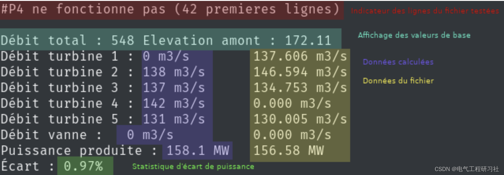
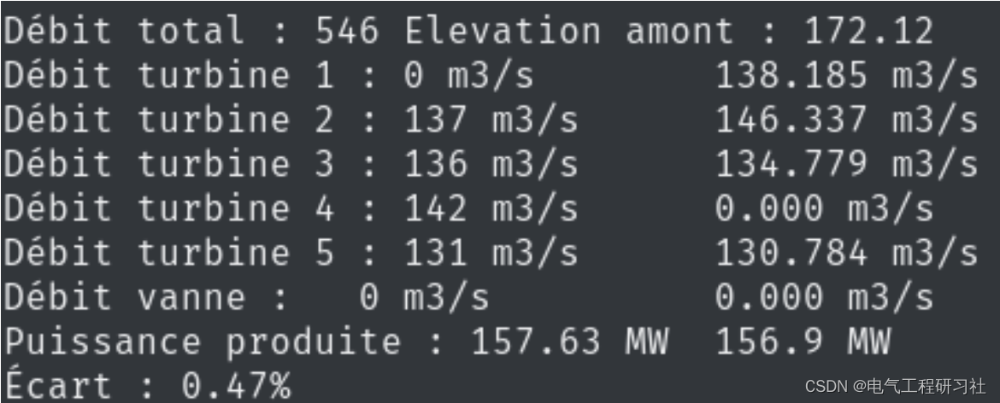
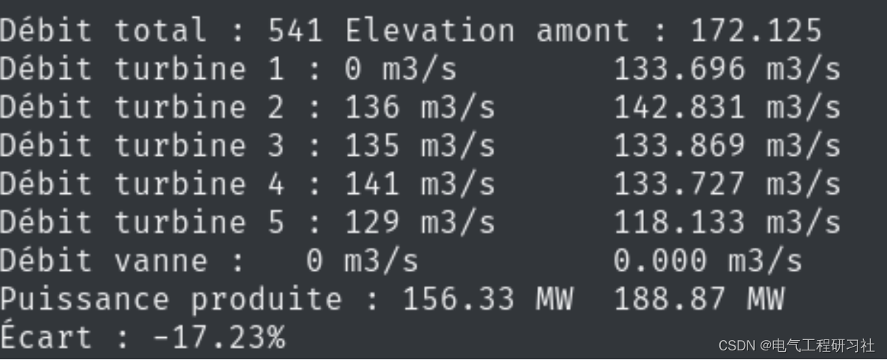
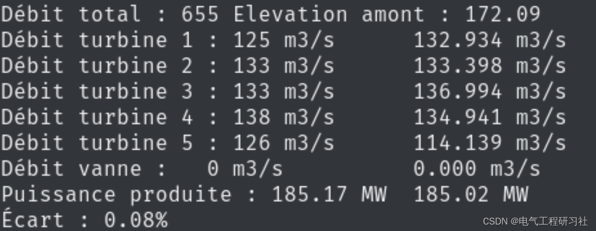
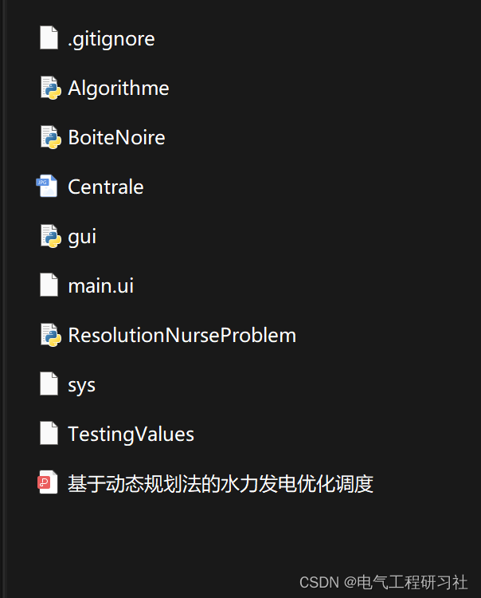

# Hydropower Optimized Dispatch Based on Dynamic Programming (Python Code Implementation)

​  
📋📋📋This article is organized as follows: ⛳️⛳️⛳️​Table of Contents: 1. Overview 2. Mathematical Model 2.1 Objective Function 2.2 Constraints 3. Running Results 4. Article Explanation and Python Code 5. Final Thoughts Dynamic programming is a method for optimization, which calculates the optimal solution by breaking down the problem into multiple subproblems. Dynamic programming based on Bellman's optimal. In other words, any optimal strategy is composed of optimal sub-strategies, where any part of the optimal solution itself is optimal. For example, in the shortest path problem between city x and city z, if the path passes through city y, then the path between x and y is optimal. Dynamic programming is applicable to several known problems, such as the knapsack problem, scheduling, shortest path, etc. Dynamic programming algorithms will solve subproblems one at a time and to solve a subproblem, it will depend on the solution found in the previous subproblem. Due to this system, the solution found by dynamic programming algorithm is optimal.
Dynamic programming reduces both space and time complexity by solving each subproblem only once. In our case of optimizing hydroelectric power production, the turbine is a subproblem. In fact, listing all possible solutions for the turbine problem using a simple recursive function starting from the first turbine is straightforward, and for each potential flow, we attempt all other turbine flows recursively. However, using this method, we find ourselves computing multiple times the power produced by each turbine at a certain flow rate. This is why in dynamic programming, we find more efficient solutions, so we store them in a dynamic programming table to be executed only once. Then, when we need them, we look up values in these tables. Dynamic programming includes two stages: the forward stage (forward propagation) and the backward stage (backward propagation).
2 Mathematical Model
To address this issue, let's first look at its mathematical formulas. The principle is to maximize power production based on the total flow (Qtot) and upstream altitude, and we seek to optimize our strategies accordingly. Therefore, we have:
The flow allocated to turbine i using Qi and the production function of turbine i (see Appendix A). For the constraints, we only have maximum total flow and minimum flow restrictions:
Therefore, we have the final model:
2.1 Objective Function
2.2 Constraint Conditions
For a more detailed model explanation, see Part 4. 3 Run Results
Editing... Editing... Editing...
4 Article Explanation and Python Code
This article only showcases part of the code, all codes can be found in:
Editing...
5 Conclusion
Partial theoretical references are from online literature, please contact the blogger if there is any infringement.

## Images

<!-- PAYMENT_BLOCK -->

## Get this dataset

- Payment link (Stripe): [Buy now](https://buy.stripe.com/3cs8yP7sY87d0vu9AB)
- Payment QR code: 

<!-- /PAYMENT_BLOCK -->
